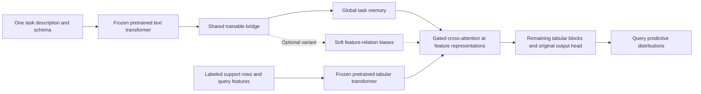

# Research: Text augmentation for tabular foundation models

This document is a dated research snapshot. The [related-work wiki catalogue](../../related_works/README.md) links to the maintained individual paper notes and PDFs in `raw/`. All collection changes must follow the [mandatory rules in AGENTS.md](../../../AGENTS.md#related-works-maintenance-mandatory); this snapshot does not define separate maintenance rules.

## Research Question

> We want to work on combining text input with tabular input in foundation models so text will support tabpfn for better results (probably in smaller regimes). Init repo and create a readme in this folder than write this idea concisely. Then create a folder docs/related_works and search for related works like TabPFN, TabICL, https://arxiv.org/pdf/2607.08093, multimodal TabPFN etc. that might be relevant and save pdfs to this folder.

## Summary

The broad combination already has direct precedents, including text encoders adapted to TabPFN and multimodal PFNs. Semantic tabular models and language-based few-shot methods supply additional comparators. The next useful step is a controlled comparison of text sources and integration methods across labeled sample sizes; this is a proposed focus, not a verified gap in the literature. Fourteen PDFs, including the requested CausalDS paper, are saved in the collection.

## Detailed Findings

### Direct TabPFN extensions

[Towards Pretraining Text Encoders for TabPFN](https://arxiv.org/abs/2606.04876) connects frozen text and TabPFN components through a trained adapter. [MultiModalPFN](https://arxiv.org/abs/2602.20223) extends PFNs to multimodal tabular learning. These are the closest precedents and should be read before choosing an architecture.

[TabPFN beyond Tabular Data](https://arxiv.org/abs/2607.11007) studies prediction on frozen multimodal embeddings, making it relevant to embedding baselines and calibration. [TabPFN-3](https://arxiv.org/abs/2605.13986) includes tabular-text results, so an evaluation should specify the model generation and variant rather than treat TabPFN as one fixed baseline.

### Semantic and text-tabular alternatives

[TabSTAR](https://arxiv.org/abs/2505.18125) addresses tables containing text fields, while [ConTextTab](https://arxiv.org/abs/2506.10707) integrates semantics into tabular in-context learning. [CARTE](https://arxiv.org/abs/2402.16785) uses semantic representations of table content for transfer across schemas. [TabText](https://arxiv.org/abs/2206.10381) provides an earlier language-representation approach, and [TabLLM](https://arxiv.org/abs/2210.10723) supplies a few-shot classification comparator based on natural-language serialization.

### Tabular foundations

The [original TabPFN](https://arxiv.org/abs/2207.01848) establishes the small-data PFN approach. [TabPFNv2](https://www.nature.com/articles/s41586-024-08328-6) is a strong small-data classification/regression reference. [TabICL](https://proceedings.mlr.press/v267/qu25d.html) and [TabICLv2](https://proceedings.mlr.press/v306/qu26a.html) provide alternative tabular foundation-model baselines. Testing text augmentation across these families would help separate model-specific effects from broader benefits; this is an experimental proposal.

### Requested benchmark

[CausalDS: Benchmarking Causal Reasoning in Data-Science Agents](https://arxiv.org/abs/2607.08093) pairs observational datasets with natural-language stories and causal reasoning tasks. It is adjacent evaluation work rather than a text-TabPFN architecture. Its setup may inspire tests of whether context supplies information missing from numerical observations; adapting it to supervised prediction would require separate experimental design.

## Sources Consulted

The [wiki catalogue](../../related_works/README.md) links to individual paper notes containing primary sources and local PDFs. At the time of this snapshot, it covered 14 works. The [manifest](../../related_works/manifest.json) records note/PDF paths and download checksums.

## Key Insights

The proposed project needs a narrower contribution than combining text with TabPFN. A practical starting point is to vary labeled sample size, text source, and fusion method while holding splits and model-selection budgets fixed. Include tabular-only, text-only, frozen embedding, and existing text-tabular baselines. Fit dimension reduction and other learned preprocessing inside training folds, and inspect text for target leakage.

## Confidence Notes

This is an initial literature collection, not an exhaustive systematic review or a reproduction of reported results. Relevance judgments and the proposed experimental focus are our synthesis. No claim of novelty or reliable small-data improvement is established by collecting these papers. Preprints and newer technical reports may change; the manifest preserves the downloaded artifacts.

## Open Questions

- Which text source should the first experiment target: row-level free text, column metadata, or external descriptions?
- Which dataset family, task type, and labeled sample sizes should define the first benchmark?
- Do simple frozen embeddings match learned adapters under a shared low-data evaluation?

These are research decisions for the experiment stage; they do not block the repository setup or literature collection.

## Clarifications Log

No clarifications were required to complete this collection.

## Follow-up Research [2026-10-15 14:35]

### Research question

> Check related works and think how we can mathematically bridge the SALSA and TabPFN for better TabPFN predictions. Without fine tuning and with fine tuning for model bridging, still getting generalist models. Maybe we can pick up CausalDS as a train/test set

### Summary and recommendation

Start with frozen SALSA-style answer probabilities as low-dimensional, target-aware features for frozen TabPFN. Compare against probability averaging before training any bridge. For task-wide descriptions such as CausalDS stories, also test a story-conditioned mixture of predictive feature views: the language model supplies a preference over views, while support labels supply predictive evidence. A shared gate or token adapter can then be trained across disjoint tasks and frozen on new tasks. These are proposed experiments; no improvement or novelty has been established.

Use freshly generated CausalDS-style scenes for bridge training and development, with the released exam reserved for evaluation. The released exam has too few binary prediction tasks to be the main evidence for generalist classification. Source inspection established generator availability, not end-to-end executability in this environment.

**Confirmed input priority:** The user selected task/domain context using fresh CausalDS scenes for the first experiment. Row-level reviews and notes are a later evaluation direction. The proposed binary observational-prediction setup remains a recommendation; model choice and the prediction-versus-causal-estimation objective are still open.

### Source grounding and overlap

- [SALSA](https://arxiv.org/abs/2510.22691) offers a decoder-only class-token scoring interface, zero/few-shot variants, and supervised LoRA adaptation. It does not establish a generalist SALSA–TabPFN bridge. Its supervised experiments adapt to individual tasks.
- [TabPFNv2](https://www.nature.com/articles/s41586-024-08328-6) conditions prediction on labeled tables after synthetic pretraining. Its causal data-generating prior is not a guarantee of causal identification at inference.
- [Text Adapter](https://arxiv.org/abs/2606.04876) already trains a text-to-TabPFN projector with both backbones frozen. A frozen-backbone projector alone is not a new contribution.
- [MultiModalPFN](https://arxiv.org/abs/2602.20223) already uses learned modality projection/pooling with downstream backbone adaptation. [TabSTAR](https://arxiv.org/abs/2505.18125) already makes representations target-aware. The proposed distinction to investigate is task-conditioned decoder scores/states, support-dependent reliability, and generalization across held-out tasks and context regimes.

### Mathematical setup

Let a task provide support data $D=\{(x_i,t_i,y_i)\}_{i=1}^n$, a task/schema description $c$, and a known set of $K$ candidate classes. Here $x_i$ is structured data and $t_i$ is independently observed row text; $t_i$ may be absent. Query labels are hidden.

Let $F_\omega$ be the frozen TabPFN predictor and $L_\psi$ a frozen instruction-tuned decoder. For a prompt $P(x_i,t_i,c)$, choose verified single vocabulary tokens $\nu(k)$ for the classes and score the next answer-token position:

$$
q_{ik}=\frac{\exp(\ell_{i,\nu(k)}/T)}{\sum_{j=1}^K\exp(\ell_{i,\nu(j)}/T)}.
$$

This class-logit normalization follows SALSA. Fix $T=1$ for the untuned baseline; tuning $T$ is calibration even if backbone weights stay fixed. A SALSA-like interface can be tested with a smaller instruction model, but transferring the paper's reported performance from its 70B backbone is an unverified hypothesis.

Implementation must respect causal decoding: the state immediately before answer token $j$ predicts token $j$. Do not feed a true answer into the scoring state. The paper's placeholder diagram does not unambiguously specify the next-token indexing, so verify this with a small controlled test. A suffix cannot condition an earlier causal state. Verify single-token mappings with the actual tokenizer and prompt boundary.

### Bridge A: fixed-weight score features

Convert $q_i$ to centered log probabilities:

$$
u_{ik}=\log(q_{ik}+\epsilon)-\frac{1}{K}\sum_j\log(q_{ij}+\epsilon),
\qquad \widetilde x_i=[x_i,u_i].
$$

Then use ordinary TabPFN context inference:

$$
p_A(y_*\mid x_*,t_*,c,D)
=F_\omega\left(y_*\mid\widetilde x_*,\{(\widetilde x_i,y_i)\}_{i=1}^n\right).
$$

Only $K-1$ independent relative scores are added, rather than hundreds of generic embedding coordinates. Support labels let TabPFN infer whether the language scores are useful and how they interact with structured features. Raw probabilities are an equally important simple baseline. Entropy and prompt disagreement can be optional features; neither is a trustworthy epistemic-uncertainty estimate by itself.

This has no new gradient training, but still learns from support labels through ICL. It does not guarantee the model will ignore bad scores. Begin with zero-shot language scores, computed by the same label-free prompt rule for support and query rows. If demonstrations are added later, support row $i$ must never see $y_i$ in its own prompt. Cross-fit or leave one out, and match demonstration budgets to reduce train/query mismatch.

For task context, score each row using its structured values plus the story. Story-only scores repeated across every row are constant features and can be removed by normalization; they are not an adequate context bridge. A useful ablation is the context increment $\Delta u_i=u_i(c)-u_i(c_0)$, where $c_0$ retains the task/class definitions but omits the domain story. This isolates a change in language judgment, not independent statistical evidence.

### Bridge B: probability fusion and a learned generalist gate

The fixed arithmetic mixture is the first comparison:

$$
p_{\rm mix}(k)=(1-\lambda)p_0(k)+\lambda q_k,
\qquad p_0=F_\omega(\cdot\mid x_*,D_x).
$$

Predeclare $\lambda$, such as $1/2$, for a fully untuned baseline. Selecting it on labels is model selection. Arithmetic mixing does not sharpen identical experts and preserves a floor $(1-\lambda)p_0(k)$, giving a per-example log-loss degradation bound of $-\log(1-\lambda)$ relative to $p_0$. It does not guarantee better accuracy or log loss.

Do not blindly multiply the probabilities. The identity

$$
p(y\mid x,t,c,D)\propto
\frac{p(y\mid x,c,D)p(y\mid t,c,D)}{\pi(y\mid c,D)}
$$

requires conditional independence of the two evidence sources given the label/context and calibrated experts using the same prior. If SALSA reads a serialization of the same numerical row, evidence is correlated. Multiplying two identical $(0.9,0.1)$ predictions produces approximately $(0.988,0.012)$ without new information. An empirical class-frequency correction does not fix arbitrary language/prompt priors. Log pooling remains a heuristic unless its assumptions are justified.

Train a shared gate $g_\phi(v)\in[0,1]$ across tasks to replace $\lambda$. Features $v$ can include support size, class-invariant entropies/disagreement, missingness, text availability, and out-of-fold support reliability. A scalar gate handles variable class counts and respects class renumbering when its inputs are symmetric. Reliability must be measured without each scored support row's label remaining in that predictor's context.

### Bridge C: context-conditioned predictive hypotheses

This is especially relevant when the text is a shared domain story. Let $h\in\mathcal H$ describe a small, predeclared set of feature views $v_h(x)$, such as full features, specified feature subsets, or interaction transformations. Include a full-feature fallback. Use SALSA-style class-token scoring over descriptions of these hypotheses:

$$
q_L(h\mid c,\text{schema}).
$$

This is a language-derived prior preference, not a calibrated probability of the true causal mechanism. Form it without support outcomes. Let $F_h$ be frozen TabPFN operating on view $h$. A prequential predictive score is

$$
\mathcal L_h=\sum_{i=m+1}^{n}
\log F_h(y_i\mid v_h(x_i),D_{<i,h}).
$$

Combine story preferences with support evidence:

$$
w_h=\frac{q_L(h\mid c)\exp(\tau\mathcal L_h)}
{\sum_g q_L(g\mid c)\exp(\tau\mathcal L_g)},
\qquad
p_C(y_*\mid x_*,D,c)=\sum_h w_hF_h(y_*\mid v_h(x_*),D_h).
$$

This changes the predictor rather than appending a constant story vector. Compare uniform view priors, language-only view weights, predictive-score-only weights, and combined weights to isolate the story's contribution. Give each view positive prior mass and avoid duplicates that arbitrarily increase aggregate mass.

Call $\exp(\tau\mathcal L_h)$ pseudo-evidence. Exact Bayesian averaging needs a genuine hypothesis prior, $\tau=1$, and coherent joint models behind the predictive conditionals; ordinary PFN outputs do not establish those properties. Define a label-independent row order and fixed warm-start size $m$, with explicit smoothing over all known classes if the prefix lacks a class. Omitting the prefix terms gives a conditional/prequential score, not a full marginal likelihood. Report sensitivity across prespecified orders. Set candidate construction, $\tau$, and all search rules on separate development tasks.

Reusing support observations for model weights and final fitted predictions is not inherently leakage; Bayesian model averaging does that. However, a large searched view set can overfit under this surrogate score. Keep it small and evaluate untouched queries. Causal parents are not automatically the best observational predictors: descendants can be predictive too. Reading a causal story or selecting parent features does not alone identify intervention or counterfactual effects.

### Bridge D: shared adapter training while retaining generalist inference

Let $h_i$ be the decoder's answer-prefix representation. A shared adapter can output a few TabPFN-compatible tokens:

$$
z_i=A_\phi(h_i,u_i,\operatorname{SetEnc}(\text{class descriptions}),c).
$$

Keep the original structured-feature encoder. Use $z_i$ alongside structured tokens in the tabular transformer. This requires an open backbone with a differentiable token-insertion interface; a frozen backbone still needs gradient flow through its operations to train the adapter. Access and integration must be checked against the selected implementation before committing to this route.

An interpretable three-branch predictor is

$$
p_\theta=(1-a-b)p_0+a\,p_A+b\,q,
\qquad a,b\geq0,\ a+b\leq1,
$$

where $p_A$ can now mean the token-adapted predictor and the shared gate returns $a,b$. First train only the bridge/gate, freezing both backbones. The cross-task objective is

$$
\min_\theta\ \mathbb E_{\mathcal T\sim\mathcal P_{\rm train}}
\mathbb E_{S,Q\subset\mathcal T,\ S\cap Q=\varnothing}
\left[-\frac{1}{|Q|}\sum_{i\in Q}\log p_\theta(y_i\mid S,x_i,t_i,c)
+\lambda_{\rm preserve}\mathcal R_{\rm preserve}
+\lambda_{\rm perm}\mathcal R_{\rm perm}\right].
$$

Train on many task-disjoint episodes, with varying support sizes, class counts, schemas, and context relevance. Balance tasks rather than rows from the largest datasets. At deployment, freeze the same bridge weights and use only the new task's support labels; no per-dataset head or gradient update is required.

Route missing text exactly to $p_0$. For irrelevant text, use a preservation loss such as $\operatorname{KL}(\operatorname{stopgrad}p_0\|p_\theta)$ on explicitly irrelevant-context episodes, not useful-text episodes. This encourages preservation but does not guarantee it for arbitrary nonempty text. Randomize row order, feature order, class IDs, and verbalizer mappings, with prediction remapping before consistency losses. Avoid fixed-$K$ output layers: share parameters per candidate class and use symmetric aggregation. Such training encourages, rather than proves, invariance of an autoregressive prompt pipeline.

If adapter-only training succeeds, consider shared LLM LoRA and optionally TabPFN LoRA on the same cross-task episodes. Keep original weights available, mix in tabular-only tasks, and evaluate ordinary language tasks if claiming language generality. Task-specific SALSA LoRA is not evidence for this proposed generalist LoRA regime.

### CausalDS feasibility audit

Inspected the official repository at commit `3d675d394f4c075a3b43bfa961b314eec8354211`, including its frozen exam, scene writer, task generator, and generation guide. No dependencies were installed and no generator/API calls were run.

- The [dataset card](https://github.com/andleb/causalds/blob/3d675d394f4c075a3b43bfa961b314eec8354211/data/README.md) explicitly marks the release evaluation-only and asks that released instances/reference answers be kept out of training corpora. Its Hugging Face configurations are test splits. Per-task fitting to supplied observations is intended evaluation behavior; global bridge training or prompt development on the frozen exam is different.
- Counting the official [main exam JSON](https://github.com/andleb/causalds/blob/3d675d394f4c075a3b43bfa961b314eec8354211/data/benchmark/main/exam.json) gives 100 tasks, with 15 ordinary prediction tasks: five binary and ten continuous. These counts refer to this release, not the generator's capacity.
- The [paper](https://arxiv.org/abs/2607.08093) spans observational prediction and causal questions. Most effect, identification, and counterfactual tasks are scene-level estimands rather than row labels. They require an explicit causal identification/estimation pipeline, not direct classifier probability fusion.
- The [scene writer](https://github.com/andleb/causalds/blob/3d675d394f4c075a3b43bfa961b314eec8354211/causalds/scene_writer.py) separates public observations/query features from private targets/graphs. Prediction features remove the outcome and its complete proxy bundle. Preserve this separation and account for calibration rows that expose gold conceptual measurements.
- The [generation guide](https://github.com/andleb/causalds/blob/3d675d394f4c075a3b43bfa961b314eec8354211/docs/generation.md) provides fresh-scene generation. Story/mapping/audit stages use an OpenAI-compatible service; defaults include Tavily and CauseNet, with documented ways to disable those extras. Public source availability does not establish that this full pipeline runs successfully in our environment.

Use CausalDS as a controlled test of task/domain context and schema semantics. It does not supply the independently observed reviews/notes needed to establish a row-level text contribution. Its graph-faithful story intentionally adds structural information; an improvement over a bare table can reflect this extra information rather than a better model of identical inputs.

### Proposed first experiment and split protocol

1. Generate fresh binary-outcome scenes, starting with clean observations and directly observed targets. Reserve published scenes and all their ablations for final evaluation. Do not use released grading data for bridge training or prompt selection.
2. Partition latent SCM/scene groups into global training, validation, and test pools before constructing episodes. Keep every paraphrase, proxy view, target variant, resampling, and verbalization from one SCM in the same pool. Use separate tests for fresh parameters, held-out mechanism/graph families, and held-out semantic domains. Domain grouping requires our own audit.
3. Within a test scene, compare identical support budgets, such as 8/16/32/64/128 labels, and identical untouched query rows. Any calibration data revealing target values counts toward this budget; calibration rows are not extra independent examples.
4. Compare table-only TabPFN, zero-shot SALSA-style prediction, fixed arithmetic fusion, raw probability/centered-logit feature augmentation, and the context-conditioned view mixture. Add generic text embeddings and the existing frozen Text Adapter family as comparators when moving to row-text datasets.
5. For all methods, test names-only, correct story, no story, matched paraphrases, shuffled/mismatched story, and anonymized names. Keep task/class definitions fixed when removing the story. Include a clearly marked privileged oracle-structure upper bound to measure how much improvement simply comes from providing structural knowledge.
6. If a frozen bridge helps across validation scenes, train one gate/adapter on training scenes, then freeze it for test scenes. Tune prompts, temperatures, view policies, adapter dimensions, and checkpoint selection only on validation scenes.
7. Report scene-level paired changes in NLL/Brier, accuracy/AUROC, calibration, runtime, and memory. Bootstrap scenes rather than treating correlated rows as independent datasets. Report failures as well as average gains.
8. Evaluate continuous outcomes separately. SALSA's discretized regression requires a support/metadata-derived grid, valid bin tokens, shared units, and distribution-aware metrics. It is not interchangeable with averaging classification probabilities; never construct bins from test targets.

### Candidate contribution and confidence

A defensible working hypothesis is: **a small, task-conditioned language interface can supply useful semantic/structural preferences, and a generalist tabular inference model can learn from a few labels when to trust them**. The strongest early contribution may be a controlled evaluation rather than a new architecture. The proposed bridge equations are designs to test, not reproduced published results.

The highest-confidence findings are the separation of SALSA and tabular blocks, overlap with existing adapters, and the released CausalDS layout/restrictions verified in source. Generator execution, improvement on unseen tasks, preservation under misleading text, and comparative compute cost remain untested. A larger text decoder may lose a cost-controlled comparison even if accuracy improves.

### Open decisions for this follow-up

1. Which open language model and TabPFN generation fit the available compute and token-interface access? Recommendation: begin with frozen output scores; do not require a 70B model or an internal adapter to test the hypothesis.
2. Is the target ordinary prediction or causal estimation? Recommendation: begin with observational prediction; design identification/abstention and effect-estimation objectives separately if expanding to causal tasks.

These two remaining decisions determine the scope of implementation. No implementation or benchmark run was performed in this follow-up.

### Clarifications log for this follow-up

- **2026-10-15T15:09:08+02:00:** In response to the first-experiment input question, the user selected “Task/domain context using fresh CausalDS scenes (Recommended).” This resolves input priority and has been integrated into the summary. It does not resolve model/compute choice or the prediction-versus-causal-estimation objective.

## Follow-up Research [2026-10-15 16:21]

### Research question and confirmed scope

> Check related works and think how we can connect text from task level (description of the problem, dataset) information with tabular foundation models like LLM Transfoermer block and TabPFN for better TabPFN predictions. New architecture that will reuse pretrained models from both worlds, still being generalist. We can pick up CausalDS as a train/test set. We want to serve text as description of the whole task/dataset.

The user confirmed **prediction of outcomes for new rows** as the first objective. One description is shared by the whole dataset/task. Row-level free text and causal-effect estimation are outside this first design. This follow-up refines the earlier bridge discussion into a direct task-conditioned architecture; it does not implement or evaluate a model.

### Recommendation

Build a **task-description-conditioned TabPFN**: a frozen pretrained language transformer encodes the shared description and schema once; a small bridge, trained across datasets, injects context into a frozen pretrained tabular transformer. Use global text memory through gated cross-attention as the minimal neural bridge. Test a second, interpretable variant in which language supplies soft biases to feature attention. Freeze the bridge too when evaluating unseen datasets; support labels are consumed by ICL, with no per-dataset gradient updates.

The hypothesis is that language supplies useful structural/semantic preferences before many labels are available. Calling this a conditional prior is an interpretation; a learned interface does not establish calibrated Bayesian priors or exact Bayesian inference.

### What the literature supports

| Precedent | Supported connection | Consequence for positioning |
|---|---|---|
| [Text Adapter](https://arxiv.org/abs/2606.04876) | Frozen language encoder and TabPFN with a trained cell-text projector. | Reusing two frozen backbones is already established; our focus is shared task context and cross-task transfer. |
| [ConTextTab](https://arxiv.org/abs/2506.10707), [TabSTAR](https://arxiv.org/abs/2505.18125) | Semantic feature representations; TabSTAR also conditions representations on target names. | Names and target tokens alone are insufficient differentiation. |
| [CAAFE](https://arxiv.org/abs/2305.03403) | Dataset descriptions guide LLM-generated feature engineering; TabPFN is used downstream. | Task-level language helping TabPFN is not new. Compare latent conditioning against code-based feature engineering. |
| [Use What You Know](https://arxiv.org/abs/2602.14972) | Causal foundation models consume partial structural knowledge through attention biases and graph encoders. | Soft structural conditioning has a close precedent, but its causal objective and training setup differ from frozen language-plus-TabPFN predictive reuse. |
| [ACE](https://arxiv.org/abs/2410.15320) | Amortized predictors can be trained to accept runtime prior/latent information. | The interface must learn how context relates to tasks; fixed random projections are not a principled conditioning mechanism. |

No exact-match global-language/frozen-TabPFN bridge was verified in this scoped search. This is not evidence of novelty. A potentially relevant OpenReview paper, *Bayesian Tabular Few-shot Learning with Causal Information*, could not be fully retrieved; its architecture and freezing regime were not verified and are not used as design evidence here. Newly consulted references are cited in this research snapshot; they have not been added to the maintained wiki collection.

### Input and prediction contract

An episode provides:

- Support table $S=\{(x_i,y_i)\}_{i=1}^n$.
- Query feature rows $X_Q$, with query labels withheld from all model inputs.
- A single description $c$ explaining the dataset, task, target, and available domain knowledge.
- A schema $m$ mapping prose variable names/definitions to actual columns and stating the target. The schema is dataset-level metadata, not a new per-row modality.

The predictor produces

$$
p_\phi(y_q\mid x_q,S,c,m).
$$

Use the existing classification or regression head of the chosen TabPFN checkpoint. Do not create a fixed dataset-specific label head. A generalist bridge must support variable schema sizes and the class-count/output limits of its actual backbone; it cannot silently remove those limits.

### Proposed architecture: global memory plus optional relational bias

**Text transformer.** Encode $c$ together with $m$ and the prediction objective once per dataset, obtaining token states $E_L(c,m)$. Use frozen encoder-style language representations or a frozen instruction decoder with readout states that can attend to the whole preceding description. Cache these states. No row values or query outcomes need to enter the language transformer. Start with a moderate-size accessible model rather than assume the 70B SALSA setup is necessary.

**Schema-aware bridge.** A learned resampler/projector maps language states to a small task memory $M_\phi\in\mathbb R^{r\times d_F}$, where $d_F$ is the selected tabular hidden size. An initial experimental range is $r=8$–$16$ memory tokens, not a claimed optimum. Preserve schema-aligned summaries $e_j$ of feature definitions and $e_y$ of the target definition. A global pooled sentence vector alone risks losing which relation concerns which column. When columns are permuted, their metadata mapping must follow them. If TabPFN groups features, combine the corresponding metadata for each actual group before conditioning group tokens.

**Tabular transformer.** Retain numerical/categorical encoding, support-label injection, row-attention masks, and the pretrained output head. Insert small gated context modules after input normalization and before feature information is irreversibly compressed. For TabPFN-2.x this can be at selected feature-attention blocks; for TabPFN-3/TabICL-style architectures it should be before or within row aggregation. This is an architectural proposal: open-checkpoint access and differentiable internal hooks must be verified for the chosen implementation. Do not assume adapters transfer between generations.

For tabular hidden representations $H^{(\ell)}$, the minimal memory injection is

$$
\widetilde H^{(\ell)} = H^{(\ell)}
+ a_\ell(S,c,m)\,W_{O,\ell}
\operatorname{Attn}\!\left(W_{Q,\ell}H^{(\ell)},W_{K,\ell}M_\phi,W_{V,\ell}M_\phi\right).
$$

Language memory is identical for every row, but row/feature-dependent queries make its contribution depend on the actual table. This avoids relying on a constant embedding repeated as ordinary scalar features, which can be removed by normalization or carry no within-dataset variation. It also avoids inventing labeled pseudo-rows from prose. Shared modules can gate updates using context and a permutation-invariant summary of support data; such summaries must not include held-out query labels.

For the structural variant, generate a bounded feature-pair preference

$$
B_{jk}=b_\phi(e_j,e_k,e_y,M_\phi),\qquad
A^{(\ell)}_{i,jk}=\operatorname{softmax}_k\!\left(
\frac{q_{ij}^{\mathsf T}k_{ik}}{\sqrt d}
+ g_\ell(S,c,m)B_{jk}\right).
$$

The shared $B$ changes relational attention across all rows while the ordinary data-derived attention remains active. Treat $B$ as a soft predictive preference, not an identified causal graph. Center/bound its magnitude and ablate its gate strength. Avoid a hard causal-parent mask: observed children and other variables can help ordinary prediction, and latent variables complicate relevance further.

Use one global-memory bridge first, then compare a relation-bias-only bridge and their combination. Training both branches immediately would obscure which interface helps.

### Reuse and generalist training

Initially freeze **all original language and TabPFN weights**. Train only the resampler, schema binding, added cross-attention/projection modules, optional relation head, and gates. Frozen TabPFN operations still need gradient flow to the bridge; wrapping the whole path in inference-only/no-gradient execution would prevent bridge training. Cache frozen language outputs when descriptions are unchanged.

Across task-disjoint episodes, optimize the held-out query predictive loss:

$$
\mathcal L(\phi)=
\mathbb E_{\mathcal T\sim\mathcal P_{\rm train}}\!\left[
-\frac{1}{|Q|}\sum_{q\in Q}\log p_\phi(y_q\mid x_q,S,c,m)
+\lambda\,\mathcal R_{\rm preserve}
\right].
$$

Use classification log loss or the selected regression head's predictive loss, rather than imitate an agent's answer prose. Randomize support size, row/feature order, schema size, class renumbering, and domain wording. Balance tasks rather than large tables. Share all bridge parameters across datasets; schema alignment and permutation augmentation encourage generality but do not prove exact invariance of the original backbones.

At test time, freeze the bridge and consume a new description, support table, and query rows. This is no per-dataset fine-tuning; it is not zero-training overall. Reusing pretrained weights does not establish good zero-shot alignment between independently pretrained latent spaces.

Mix contextual episodes with ordinary tabular episodes and varied descriptions, including missing, irrelevant, and mismatched context. Train preservation on explicitly irrelevant/no-text episodes, not on useful-context episodes where the output should change. Initialize close to the original predictor, for example a zero output projection with a nonzero gate. Do not initialize both the residual output and its multiplicative gate to zero, which can block learning.

Implement missing context as an exact bypass to vanilla TabPFN. For arbitrary misleading nonempty text, a learned gate provides no safety guarantee. An optional output mixture with the original predictor can bound log-loss deterioration, but adds prediction cost and is an ablation rather than a promised solution.

A bridge trained only on a narrow set of CausalDS motifs is a CausalDS-specialized bridge until broader evaluation demonstrates otherwise. Generalist evidence needs held-out mechanisms, domains, schemas, targets, and eventually real datasets with genuine task descriptions. Consider shared low-rank backbone adaptation only after frozen-backbone bridging shows a reproducible benefit; this changes the preservation and compute comparison.

### CausalDS adaptation

[CausalDS](https://arxiv.org/abs/2607.08093) includes Rung-1 prediction tasks with held-out rows, alongside graph, effect, and counterfactual tasks. Its stories are audited against qualitative structure, while numerical data come from separately sampled mechanisms. The narrative's units/ranges may differ from released measurement scales. Therefore context can suggest conditional independences, latent common causes, or measurement grouping, but should not be assumed to reveal true coefficients, signs, or scales. See the paper's scene format and generation/measurement instructions.

Start with newly generated, clean scenes with directly observed binary or continuous outcomes. Use $c=$ story + task definition, $m=$ public schema, $S=$ a fixed label budget, and $Q=$ held-out feature rows. Report binary classification and regression separately. Add proxy variants only after defining how calibration rows and reconstructed targets enter the label budget.

The [official release documentation](https://github.com/andleb/causalds/blob/main/data/README.md) treats the frozen release as evaluation data. Use fresh generation for bridge training/development, preserve the released main/ablation problems for final evaluation, and keep private grading artifacts out of model-facing inputs. Fresh scene generation is documented in the [generation guide](https://github.com/andleb/causalds/blob/main/docs/generation.md); story/mapping/audit stages require an external language-model service. Source availability has been inspected, but this workflow has not been executed in our environment.

Split by underlying SCM/problem before making episodes. Keep row resamples, targets, paraphrases, domain renamings, and observation variants of the same problem together. Test fresh parameters, held-out mechanism/graph families, and held-out semantic domains separately. Within every test scene, all methods receive the same support rows and untouched queries. A development phase on released exam labels would invalidate the intended final-test separation.

Do not replace treatment values in a query and call the resulting ordinary prediction an intervention. The confirmed first objective is $P(y\mid x,S,c,m)$; effect and counterfactual extensions need identification, estimators, and abstention beyond this design.

### Deciding experiments

1. **Can a conditioned frozen tabular backbone use structural information at all?** Compare vanilla TabPFN with a small shared bridge given explicitly privileged oracle relation/structure metadata on fresh train/validation scenes. Oracle data are never model inputs for the ordinary-text evaluation. Failure here can expose either a poor interface or unhelpful structural information; it does not by itself prove that task text is useless.
2. **Can language supply the useful part?** Compare oracle conditioning, explicit story-to-soft-relations extraction, and continuous language-memory conditioning. Keep the statistical predictor and episode splits matched.
3. **Does one bridge transfer?** Compare shared bridge inference on held-out scene families against no adaptation. Optional per-task fine-tuning is a separately labeled comparator, not the claimed deployment mode.

Core baselines: vanilla TabPFN; headers/target semantics only; identical context repeated as numeric features as a deliberately weak control; global cross-attention; soft relation biases; their combination; a frozen language-only or SALSA-style row-prompt classifier; CAAFE with the same permitted context and support budget. A language-only row-prompt comparator receives serialized row values and has different compute from the proposed encode-once architecture; report that difference. CAAFE feature-search selection must stay within support/development data.

For every bridge, compare full correct context, description removed while keeping schema alignment, paraphrases, irrelevant context, and matched contradictory/swapped stories. Keep feature identifiers, target definitions, and task wording fixed where possible so the ablation changes domain information rather than breaking the input contract. Include renaming/anonymization tests to distinguish language memorization from relational use. When a swapped story is deliberately inconsistent with the table, label it a robustness test rather than a valid alternative data-generating truth.

Use support sizes such as 8/16/32/64/128, paired within scenes. Evaluate NLL/Brier and AUROC for classification; predictive NLL when supported, RMSE, and interval coverage/width for regression. Bootstrap scenes rather than correlated rows; report mean paired gains and degradation tails, text overhead amortized over query counts, bridge training cost, and memory. The deciding result is improvement on unseen small-data tasks with correct context, near-baseline performance with irrelevant context, and explicit reporting of failures. No such result has been measured yet.

### Confidence and remaining decisions

The distinction between row text and task-level conditioning is clear, and there are verified precedents for frozen adapters, feature generation, and structured-prior injection. The proposed combination, gains, robustness, and generalist transfer remain hypotheses. The closest OpenReview candidate needs full source review before making a novelty claim. No model implementation, dependency installation, or CausalDS generation was performed.

Two implementation decisions remain: (1) an accessible language model and a specific open TabPFN checkpoint with differentiable internal hooks, based on compute; (2) whether the first bridge uses global memory alone or soft relations alone. Recommended default: validate an oracle soft-prior interface, then test frozen-language global memory and soft relations separately before combining them.

### Clarifications log for this follow-up

- The user confirmed **Predict outcomes for new rows** in response to the first-objective question. This resolves the prediction-versus-causal-estimation scope for the initial experiment. Task-wide description input was already explicit in the request.
